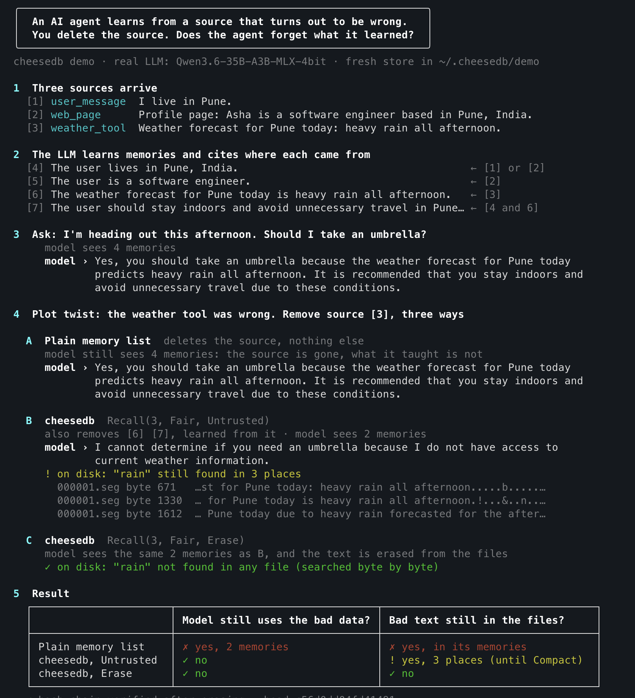

<p align="center"></p>

# CheeseDB

**A database engine purpose-built for AI memory.**
Native Go · Provenance-aware · Revocable · Embedded

Every memory knows its sources. Ask it anything in plain English. Recall a bad source, and everything learned from it goes too.

An embedded, append-only, hash-chained memory database for AI agents, written in Go with the standard library only. Use it from Go, from the `cheesedb` command, or from Claude Code, Cursor and other MCP apps.

Website: **[cheesedb.dev](https://cheesedb.dev)**

> **Status: preview.** cheesedb is in active development. It has not yet had an independent security review, and the API and on-disk format may change before v1.0, so it is not yet recommended for production data. See [Limits](#limits) and the [changelog](CHANGELOG.md).

## Why cheesedb

### The problem

An agent's memory is built from sources it cannot fully trust: user messages, web pages, documents, tool results. Sooner or later one of them turns out to be:
- **wrong:** a tool returned bad data;
- **malicious:** a web page planted instructions or false facts (prompt injection, memory poisoning);
- **private:** a user asks for their data to be deleted.

Deleting that source is not enough. Everything the agent *learned* from it stays in memory, and the agent keeps acting on it. A plain memory store cannot tell which memories came from where, so it cannot remove them. The [demo](#try-it) shows this with a real LLM: after the bad source is deleted from a plain memory list, the model still gives the same wrong answer.

### What cheesedb does

- **Every memory records its sources.** A memory is stored with the sources (or other memories) it was learned from. The engine refuses a memory without one.
- **Recall removes exactly what depended on a source.** One call removes the source and every memory built on it, however deep the chain goes. Memories that are still backed by another, independent source survive (`Fair`); or remove everything the source ever touched (`Strict`).
- **Ask it in plain English.** With an embedding model of your choice, cheesedb finds memories by meaning (`search`), answers questions from them (`ask`), and forgets what you describe after you confirm (`forget`). A recalled memory is never found again. Without a model, everything else works the same.
- **Erase really erases.** `Recall(..., Erase)` removes the text from the files on disk before it returns. `cheesedb find` searches the raw bytes to prove it.
- **The history cannot be edited silently.** Every record is chained by hash to the one before. Damage or edits are detected on every open, and erasing text keeps the chain verifiable.
- **Agents are isolated by design.** Each agent is reached only through its own token. No method takes another agent's name, so a prompt-injected tool holding one agent's handle has no way to reach another.
- **Embedded and dependency-free.** A Go library and a folder on disk: no server, no external dependencies.

### Why not SQLite, PostgreSQL or a graph database?

You can model sources and memories in SQL, or as a graph in Neo4j. We did both, to compare: the same data on all four engines, with the same durability (every write flushed to the physical disk before it is acknowledged).

**Benchmarks** with 1M memories per agent, median of 3 runs, on an Apple M1 Max (macOS, internal SSD), SQLite 3.53, PostgreSQL 17 and Neo4j Community 2026.10. Full results, method and caveats: [BENCHMARKS.md](BENCHMARKS.md).

| | cheesedb | SQLite | PostgreSQL | Neo4j |
|---|---|---|---|---|
| Recall that removes 10,000 memories | **5.5 ms** | 235 ms | 1.82 s | 67 ms |
| Recall that removes 20 memories | **4.8 ms** | 7.1 ms | 10.5 ms | 6.8 ms |
| Read one memory by id | **1.6 µs** | 7.0 µs | 44 µs | 179 µs |
| Durable write (one memory) | **4.7 ms** | 5.3 ms | 6.6 ms | 6.3 ms |
| Startup, ready for the first query | 667 ms | **0.1 ms** | 2.7 ms | 1.0 ms¹ |
| Disk per memory | 314 B | **249 B** | 546 B | 496 B |
| RAM per memory while open | 205 B | page cache only | shared buffers only | JVM heap and page cache |

¹ A new connection to a server that is already running; booting the Neo4j server took 6.5 to 8.2 s. PostgreSQL and Neo4j ran over TCP on localhost, which adds a round trip to each statement. We wrote the Neo4j model and queries ourselves, and an expert may do better.

- **Recall is where it wins.** cheesedb keeps the dependency graph in memory and removes 10,000 memories with one write: about 12x faster than Neo4j, 43x faster than SQLite and 330x faster than PostgreSQL. The SQL versions run several statements for each affected memory. A graph database fits the job better, and Neo4j is the closest competitor, but it is still slower.
- **The rules live in the engine, not in your code.** No memory without a source, no memory built on a recalled source, recalls are permanent, agents cannot see each other. With SQL or a graph database you write and test these yourself.
- **Erasure is built in.** In a general database, a deleted row's bytes can stay in the files (free pages, the write-ahead log) until a vacuum or checkpoint. cheesedb's `Erase` rewrites the file without them before it returns.
- **Writes are about even,** because the disk flush dominates for every engine.

### When to use something else

- **You need SQL-style queries, filters or keyword search.** cheesedb finds by id or [by meaning](#ask-in-plain-english). Keep other queries in your database, store only memory ids there, and check each result against cheesedb.
- **Startup time matters with very long histories.** cheesedb replays its log when it opens an agent: about 0.7 s at 1M memories. SQLite opens instantly. Snapshots are planned.
- **An agent's memory does not fit in RAM.** cheesedb keeps about 205 bytes per memory in memory, plus about 0.8 KB per searchable memory (768 values, one byte each).
- **You need production guarantees today.** cheesedb is a preview; see [Limits](#limits).

## Install

```
go get github.com/govinargo-labs/cheesedb                          # the library
go install github.com/govinargo-labs/cheesedb/cmd/cheesedb@latest  # the command
```

Requires Go 1.26.5 or newer. Developed and tested on macOS; Linux runs the same tests in CI. Windows is not supported yet.

## Quick start

The peanut story, from the command line. A user is allergic to peanuts; a restaurant's web page says its satay sauce is peanut-free; the page turns out to be wrong.

```
cheesedb agent create story
cheesedb lot story user_message "I am allergic to peanuts"                           # lot 1
cheesedb lot story doctor_note "Allergy test result: peanut allergy confirmed"       # lot 2
cheesedb lot story web_page "Spice Garden menu: our satay sauce is peanut-free"      # lot 3
cheesedb remember story "The user is allergic to peanuts" 1 2                        # memory 4: from 1 OR 2
cheesedb remember story "Spice Garden's satay sauce has no peanuts" 3                # memory 5
cheesedb remember story "The satay at Spice Garden is safe for the user" 4,5         # memory 6: needs 4 AND 5
```

**With an embedding model** ([setup](#ask-in-plain-english)), ask in your own words. Memories saved before the model was set up become searchable with `cheesedb embed`:

```
cheesedb embed story
cheesedb search story "can the user eat the satay at Spice Garden?"
# 6: The satay at Spice Garden is safe for the user (match 0.81)
# 5: Spice Garden's satay sauce has no peanuts (match 0.77)
# 4: The user is allergic to peanuts (match 0.57)
```

**Without one**, list what is alive: `cheesedb active story`.

Then the web page turns out to be wrong:

```
cheesedb recall story 3 fair erase        # recalled 3; memories removed: [5 6]
cheesedb search story "can the user eat the satay at Spice Garden?"
# 4: The user is allergic to peanuts (match 0.57)
cheesedb find story "peanut-free"         # not found anywhere (searched every file, byte by byte)
cheesedb recall story 1 fair erase        # memories removed: []: the doctor's note still backs the allergy
cheesedb verify story                     # OK. head fingerprint: ...
```

[`examples/plain-english`](examples/plain-english) runs this story step by step, with `ask` and a chat model, for a demo or a screen recording.

## Example

```go
s, err := cheesedb.Open("/data/cheesedb")   // a folder you choose, created 0700
tok, err := s.CreateAgent("alice")        // returns Alice's token, once: keep it safe
alice, err := s.OpenAgent(tok)            // the only way to reach Alice's data
defer alice.Close()

a, _ := alice.AddLot("user_message", []byte("I live in Pune"))
b, _ := alice.AddLot("web_page", []byte("profile: lives in Pune"))
c, _ := alice.AddLot("weather_tool", []byte("Pune: rain"))

m1, _ := alice.Remember([]byte("user lives in Pune"), cheesedb.Leg{a}, cheesedb.Leg{b}) // learned from A, or from B
m2, _ := alice.Remember([]byte("Pune is rainy"), cheesedb.Leg{c})
m3, _ := alice.Remember([]byte("carry an umbrella"), cheesedb.Leg{m1, m2})            // needs M1 AND M2

removed, _ := alice.Recall(c, cheesedb.Fair, cheesedb.Untrusted) // the weather tool was wrong
// removed == [m2, m3]; m1 survives because it does not depend on C
```

## Ask in plain English

cheesedb can find memories by meaning, so you and your AI can ask in your own words: "can the user eat the satay?" finds "the satay sauce has no peanuts". It needs an embedding model, which turns text into a list of numbers (a vector) so that texts with similar meaning get similar numbers. cheesedb stores the vectors, searches them, and removes them when their memory is recalled. The library never calls a model: the `cheesedb` command and its MCP server do, with the model you set up.

**Set it up** by adding an embedding model to `~/.cheesedb/llm.conf`. Any OpenAI-compatible server works (Ollama, LM Studio, oMLX, vLLM, or a hosted API); a local one keeps your memories on your machine:

```
embed_base_url = http://localhost:11434/v1     # default: base_url
embed_model    = nomic-embed-text               # e.g. after: ollama pull nomic-embed-text
# embed_api_key = your-key                      (only if the server needs one)
```

If your chat server also serves the embedding model, `embed_model` alone is enough: the server and key are taken from `base_url` and `api_key`.

**Use it:**

```
cheesedb search alice "what should I eat?"    # the closest live memories, best first
cheesedb ask alice "what should I eat?"       # search, then the chat model answers from those memories only
cheesedb forget alice "the pizza place"       # shows the closest memory and what goes with it; erases after a yes
cheesedb embed alice                          # make memories saved before the model was set up searchable
cheesedb index alice                          # the agent's index and its model
```

Every memory saved with `remember` (in the command and in the MCP server) is made searchable at once, and MCP apps get a sixth tool, `search`. If the model is down, the memory is still saved and the answer says it is not searchable yet; `cheesedb embed` catches up. After changing the model, run `cheesedb embed` again: vectors of two models cannot be compared, so it rebuilds the index.

**Without an embedding model**, nothing changes: sources, memories, recall, erase, verify, reading by id, listing live memories and the five other MCP tools all work, and nothing is sent anywhere. If you already have a vector store, keep it, store only memory ids there, and check each result against cheesedb.

**From Go**, with vectors from any model:

```go
alice.CreateIndex("default", 768, "nomic-embed-text") // dims and a label for the model

alice.Embed("default", m3, vec)                       // vec []float32 from your model
alice.EmbedBatch("default", items)                    // many at once, one disk sync per batch

hits, _ := alice.Search("default", queryVec, 5)       // []Hit{ID, Score}, best first
for _, h := range hits {
    it, _ := alice.Get(h.ID)                          // the text comes from the ledger
    fmt.Println(h.Score, string(it.Data))
}

ids, _ := alice.WouldRecall(m3, cheesedb.Fair)        // what a recall would remove, without removing it
```

- **A recalled memory is never returned.** Recall removes the vectors of everything it removes, at once. With `Erase`, the vectors are erased from disk together with the text, and both hash chains still verify (`Verify`, `VerifyIndex`). A vector can be turned back into an approximation of its text, so cheesedb treats it like the text.
- **Exact search, small in RAM:** the question is compared with every vector (cosine similarity), so there are no missed results and nothing to tune. In memory each vector takes one byte per value (about 0.8 KB at 768 values); the exact float32 values stay on disk, and the few rows that could still be in the top results are re-checked with them, so the answer is the same as a full float32 scan. The time grows with the number of memories; see [How it scales](#how-it-scales).
- **`ask` sends only what search found** (10 memories by default) to the chat model, and tells it never to treat a missing memory as an answer, so it is told to say "I do not know" instead of guessing.
- **`forget` finds memories, not sources.** Sources are not in the search index; recall a source by its number. It shows everything that would go before it erases anything (`WouldRecall`).
- **One index per model.** Vectors from different models cannot be compared. From Go, to switch models, create a new index, embed into it, then `DropIndex` the old one.
- **Without an index, nothing changes:** same files, same head fingerprint, same speed. An index lives in its own folder with its own log ([ARCHITECTURE.md section 9](ARCHITECTURE.md#9-vector-indexes)).

A Go program, offline with a stand-in embedder that matches shared words, or with a real model:

```
go run ./examples/vector-search
EMBED_BASE_URL=http://localhost:11434/v1 EMBED_MODEL=nomic-embed-text go run ./examples/vector-search
```

## How it scales

cheesedb's own cost with a search index (768 values per memory), on an Apple M1 Max. No embedding model is included: with a local one, turning a question into a vector took 17 ms. Median of 3 runs; method and every number: [BENCHMARKS.md](BENCHMARKS.md#search-index-cheesedbs-own-cost-by-size).

| Memories in one agent | 1,000 | 10,000 | 100,000 | 1,000,000 |
|---|---|---|---|---|
| Disk: memories / search index | 0.3 MB / 3.1 MB | 3 MB / 31 MB | 30 MB / 311 MB | 300 MB / 3.1 GB |
| RAM with the index loaded | 1.4 MB | 11 MB | 99 MB | 1.1 GB |
| Search, store kept open (Go) | 1.1 ms | 2.2 ms | 18 ms | 142 ms |
| Search per `cheesedb` command or MCP call | 9.7 ms | 82 ms | 0.76 s | 7.5 s |
| Recall with Erase per command or MCP call | 30 ms | 120 ms | 0.85 s | 7.6 s |

The command and the MCP server open the store for every call, so each search reloads the index; they suit agents of up to about 100,000 memories. A Go program that keeps the store open loads it once. With real embeddings at 1M, search still ranked the right memories first among a million look-alikes, and none came back after their source was recalled.

## Try it

The `cheesedb` command is a command-line tool with one command per feature, and a demo with a real LLM:

```
go install ./cmd/cheesedb     # puts cheesedb in ~/go/bin (add that folder to your PATH)
cheesedb help                 # every command
cheesedb agent create alice
cheesedb lot alice weather_tool "Pune: rain"
cheesedb demo                 # needs an OpenAI-compatible LLM (see cmd/cheesedb/llm.go)
```

It keeps its data in `~/.cheesedb` (change it with `CHEESEDB_DIR`). The LLM commands read their server and model from `~/.cheesedb/llm.conf` (search adds an embedding model there; see [Ask in plain English](#ask-in-plain-english)):

```
base_url = http://localhost:8000/v1
model    = your-model-name
# api_key = your-key        (only if your server needs one)
```

The demo tells one story three ways. An agent learns from a user message, a web page and a weather tool. Then the weather tool turns out to be wrong. Here is a real run:

<p align="center"></p>

**How to read it**
1. **Three sources arrive.** Each one is stored as a lot with a label: `user_message`, `web_page`, `weather_tool`.
2. **The model learns memories and says where each came from.** The arrow on the right lists the sources: memory `[6]` came from `[3]`, the weather tool. Memory `[7]` was built on `[4]` and `[6]`.
3. **Ask a question.** The model sees all 4 memories and answers from the weather forecast.
4. **The weather tool was wrong, so remove source `[3]` three ways:**
   - **A, a naive memory list.** It deletes the source and nothing else. The model still sees the memories built from it, and gives the same answer.
   - **B, cheesedb with `Untrusted`.** One call removes `[3]` and everything learned from it, `[6]` and `[7]`. The model sees only 2 memories, so it no longer knows the forecast. The text is still in the files, and the demo finds the word "rain" in 3 places.
   - **C, cheesedb with `Erase`.** The model sees the same 2 memories, and the text is gone from the files. A search of every byte finds nothing.
5. **The table sums it up:** does the model still use the bad data, and is the bad text still on disk?

`cheesedb find` runs the same byte-by-byte search, so you can check your own data.

## Use from AI apps (MCP)

`cheesedb mcp <agent>` serves one agent's memory to any app that speaks the [Model Context Protocol](https://modelcontextprotocol.io) (Claude Code, Cursor, Claude Desktop and others), with no code. The app starts it and talks to it over standard input and output; nothing listens on a network port.

```
cheesedb agent create alice                      # once; the token is saved in ~/.cheesedb/tokens
claude mcp add cheesedb -- cheesedb mcp alice    # Claude Code
```

For apps with a settings file (Cursor, Claude Desktop), add the same command:

```json
{ "mcpServers": { "cheesedb": { "command": "cheesedb", "args": ["mcp", "alice"] } } }
```

The model gets five tools, and a sixth, `search`, when an embedding model is set up ([Ask in plain English](#ask-in-plain-english)):

| Tool | What it does |
|---|---|
| `add_lot` | Registers a new outside source (a user message, a web page, a tool result) and returns its id. |
| `remember` | Stores something learned, with `legs`: the ids of the lots or memories it came from. |
| `recall` | Removes a lot or memory and everything that depended on it, in two calls (see below). The text is erased from disk unless the model passes `erase: false`. |
| `get` | Reads one lot or memory by id. The text of a recalled item is never shown. |
| `list_memories` | Lists the memories still alive, newest first, in pages. |
| `search` | Finds the memories closest in meaning to a question, best first. Recalled memories never appear. |

A recall cannot be undone, so `recall` takes two calls. The first removes nothing: it lists what would be removed and gives a confirm code, and the model is told to show you the list and call again with the code only if you agree. The code fits only that exact list: if anything changes in between, the model gets a new preview instead. If your app supports MCP elicitation (forms a server can show you), the second call also asks you directly, in a form the model cannot fill in, and nothing is removed without your tick. In other apps the two calls are a speed bump, not a lock: a model that ignores its instructions can make both. There, set `recall` to need your approval in the app's tool permissions.

With an embedding model, the server also tells the model to search before it forgets a memory you describe in words. Search finds memories, not sources: to remove a source, the model recalls the id `add_lot` gave it.

The agent is fixed by the command line, and no tool takes an agent, so the model cannot switch to another agent through the tools. A tool that fails (an unknown id, a recalled parent) returns its reason to the model, which can correct its next call.

Things to know before you rely on it:
- **The model declares the sources and legs itself.** A recall is only as complete as the legs it wrote, and a prompt-injected model can declare them wrongly or recall things it should not (see [Limits](#limits)).
- **A model that can also run shell commands as you can skip the tools** and read every agent's files directly. Isolation holds only when the tools are the model's only way to the data. For real separation, the data would have to belong to another OS user, which is what the planned memory server is for.
- **Each tool call opens the store and closes it again**, so a second app window or the `cheesedb` command can use it in between. The cost is the replay time under [Limits](#limits): small for a young agent, about 0.7 s per call at 1M memories. A `search` also reloads the index: 10 ms at 1,000 memories, 0.76 s at 100,000, 7.5 s at 1M ([How it scales](#how-it-scales)).
- Data lives in `~/.cheesedb`, or in `CHEESEDB_DIR` if the app starts the command with that variable set, as for every `cheesedb` command.

## Concepts

- **Lot:** a source the agent learned from (a user message, a web page, a tool result). The caller labels it; cheesedb does not judge sources.
- **Memory:** something the agent knows.
- **Leg:** one way a memory was learned. A leg holds while ALL its parents are alive; a memory may have several legs.
- **Fair recall:** a memory survives while ANY of its legs holds.
- **Strict recall:** a memory dies if the recalled source is ANYWHERE in its history.

## Guarantees

cheesedb enforces these itself; callers cannot get around them through the API:
- a memory always has at least one leg, and is never built on a recalled (dead) parent;
- recall is permanent;
- an agent's handle reaches only that agent's data (isolation by token);
- every write is on disk (`fsync`) before it is acknowledged, and a crash loses nothing that was acknowledged;
- damaged or edited records are detected (crc, content digest, hash chain);
- a search never returns a recalled lot or memory, and `Erase` removes their vectors from disk too.

Design: [ARCHITECTURE.md](ARCHITECTURE.md). Security: [THREAT_MODEL.md](THREAT_MODEL.md). Speed and size, including where cheesedb is slower than SQLite and PostgreSQL: [BENCHMARKS.md](BENCHMARKS.md).

## Limits

Read these before relying on cheesedb.

**Security**
- **Tamper-evident, not tamper-proof (v1).** Anyone who can write the files can:
  - change a record and rebuild every hash after it;
  - change or remove the newest records;
  - redact a record.

  The files alone cannot reveal any of these. `Verify()` returns a **head fingerprint**: keep a copy somewhere else, and compare it later to detect them. v2 plans signed records and an external witness.
- **Isolation stops mistakes and prompt injection, not the host program.** A tool or agent holding Alice's handle cannot reach Bob. But the program that holds the store, or anyone with access to the folder as that OS user, can read every agent's files directly.
- **Tokens are shown once.** The store keeps only a hash of each token. A lost token cannot be recovered; the agent can only be deleted.
- **Over MCP the model is not trusted, but it is powerful.** It can add lots, declare legs, and recall (and by default erase) anything in its agent. An app that gives the model a shell lets it bypass the tools altogether. See [Use from AI apps](#use-from-ai-apps-mcp).

**Data**
- **Legs are declared by the caller.** Recall removes exactly what the declared legs say depends on a source. If a memory was really learned from a source but no leg says so, recalling that source will not remove it.
- **Only `Erase` removes text from disk.**
  - `Recall(..., Erase)` erases the text of the recalled source and of every dead memory below it before returning.
  - `Recall(..., Untrusted)` hides those memories from the agent, but their text stays in the files until `Compact()`, which runs only when you call it.
  - Memories still alive through another source keep their text.
- **Deleting is not secure erasure.** Earlier backups, snapshots and copies keep their data. SSDs and file systems (such as APFS) may keep old blocks after a file is removed.
- **Agent names are compared byte by byte.** Two names that look the same but are encoded differently in Unicode are two different agents.

**Operations**
- **Damage near the end of an agent's log is cut off, not refused.** A crash can leave a half-written batch (up to about 1 MiB) at the end of the active segment, so `Open` cuts any damage in that last region and reports it in `Report.DroppedBytes`. Real damage there, even one flipped byte, therefore drops every record after it. In a young agent whose log is under 1 MiB, that can be the whole log. Check `Report()` after opening. Sealed segments do not have this weakness: damage there is always `ErrCorrupt`. Batch commit markers could remove it later.
- **Windows does not flush directories.** Windows rejects `Sync` on a directory handle ("Access is denied"), so `syncDir` is a no-op there: a segment or agent folder created, a rename, or a seal file written just before a crash is not guaranteed on disk when the write returns. NTFS journals metadata, so the entry is usually recovered, but the guarantee is weaker than on macOS and Linux. Windows support remains on the roadmap; see issue #26.
- **One open store per folder.** `cheesedb.Open` locks the folder; a second process gets `cheesedb.ErrLocked` until the first calls `Close`. The lock works on macOS, Linux, the BSDs and Windows, on a local disk. It may not work on network drives (NFS, SMB), and other systems (for example Solaris, AIX) get no lock.
- **Startup replays the whole log.** It grows with history: about 0.7 s for an agent with 1M memories ([BENCHMARKS.md](BENCHMARKS.md)).
- **The whole memory graph is kept in RAM:** about 205 bytes per memory. An agent's graph must fit in memory.
- **About 200 durable writes per second per agent** on the test machine, limited by `fsync`. Different agents write in parallel.
- **A damaged agent key file stops the whole store from opening.** It is reported rather than skipped, because skipping would hide that agent's data.
- **Search is exact, and its index lives in RAM.** The index format may still change. Every question is compared with every vector, so search slows as an agent grows; every vector is kept in RAM at one byte per value (about 0.8 KB at 768 values), and the first search after opening reads the whole index from disk. Each `cheesedb` command and each MCP tool call opens the store again, so at 1M memories every search pays that load ([How it scales](#how-it-scales)). No keyword search and no filters yet.
- **A damaged index blocks `Erase` and `Compact` for that agent** until it is dropped, because they could not erase its vectors. So does a dropped index whose folder could not be deleted. The agent itself still opens and works. If a crash interrupted an erase and an index is damaged at the next open, the erase stays pending, text included, until the index is dropped and `Compact` runs (`Report().UnfinishedErase` says so).
- **The embedding server sees what is remembered and searched.** The `cheesedb` command and MCP server send each new memory's text, and each search question, to the embedding server you set up. A local server keeps them on your machine; a hosted one keeps whatever its provider keeps, and an `Erase` cannot reach that copy.
- **Older versions ignore indexes.** If a version without indexes erases a memory, its vectors stay on disk until a current version next loads the index. Do not use an older version on a store with indexes when erasure matters.

## Roadmap

Planned work, roughly in order. Plans can change, and nothing here is a promise of a date.

**Toward v1.0** (a stable API and on-disk format)
- **Windows support.** The file lock already works; directory flushing and replacing an open file during `Erase` are the gaps.
- **More fuzzing and crash tests.** The record decoder already has a fuzz test. Still to do: feed damaged and truncated files to `Open`, and kill the process mid-write, to check recovery.
- **Independent security review** before anything is recommended for real data.
- **Batch commit markers,** so recovery can tell a half-written last batch from older damage exactly (see [Limits](#limits)).

**Next**
- **Shared memory between agents.** A shared space with named members and roles (read, write, admin), every record showing who wrote it, and a way to carry a recall of a shared memory into the private memories built on it. Design in progress.
- **Automatic compaction,** for example when dead text passes a size threshold. Today `Compact()` runs only when you call it.
- **Encryption per agent.** The record format already reserves a key id for it.

**Memory server** (v2)
- A server for several programs, over a Unix socket only, with per-agent tokens and access logging.
- **Read tracking:** what an agent read while answering becomes part of what its new memories depend on.
- **Trust levels per source type,** set by a rule table you configure.
- **Signed records and signed head fingerprints,** sent to an outside witness, so edits by someone with file access can be detected (see [Limits](#limits)).
- The MCP server moves onto the memory server, so several apps share one running process.

**Search** (v2.5)
- **Faster search for large agents:** keeping the index loaded between MCP calls, a lighter load, and an approximate index (IVF).
- **Keyword search,** and search that combines keywords with meaning.
- **Sources in the search index,** so `forget` can find a source by description too.

**Scale** (v3)
- **Snapshots,** so opening an agent loads a saved state and replays only newer records, instead of the whole log.
- Concurrent writers across agents, and log-shipping replication checked by the hash chain.

**Under consideration** (candidates we are weighing, not commitments; each needs a design first)
- **Lossless compaction for long conversations.** Store every message and tool result as a source, and make a conversation's summary a memory linked to them. A detail the summary dropped can then be pulled back exactly, and recalling a message also removes every summary built from it. Long agent sessions today lose earlier details when they are summarized to fit the context window.
- **Superseding outdated facts.** "I moved to Mumbai" retires "lives in Pune" and everything built on it, with a record of why, instead of both staying and contradicting each other.
- **Blast radius and trace.** For a source: every memory it shaped, before or after a recall. For a memory: the sources behind it. Also as MCP tools, so a model can find and recall a source it did not save in the same conversation.
- **Source versions.** When a document is updated, or access to it is revoked, the answers and summaries built from it become stale or are removed, instead of lingering in caches.
- **Timestamps and model version on records,** for traceability rules such as the EU AI Act's logging duty, while `Erase` still removes the content.
- **A memory-mapped vector file,** so the command and the MCP server search without reloading the whole index on every call.
- **Session summaries** for MCP apps that cannot hand cheesedb whole conversations.

## About the name

"Lot" and "recall" are food-safety words. A cheese maker records which milk lots went into which wheels, so when one lot turns out to be contaminated, they recall exactly the cheese made from it. cheesedb does the same for what an agent remembers.

## License

Apache License 2.0. See [LICENSE](LICENSE).
