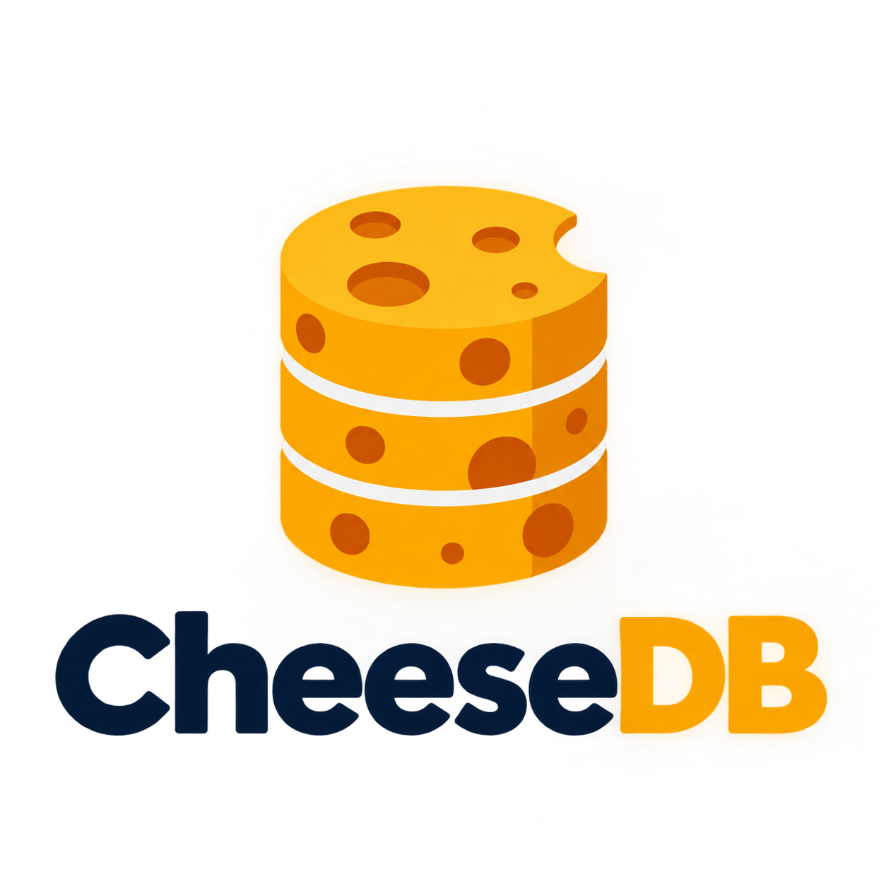
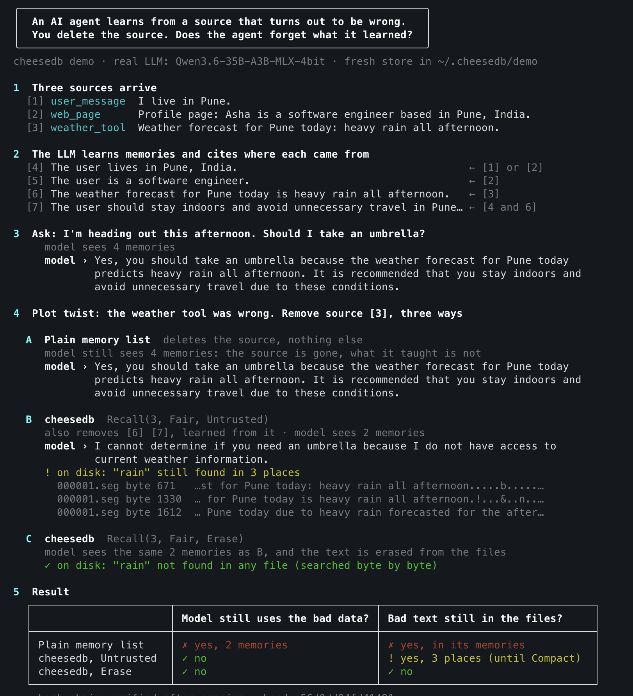

<p align="center"></p>

# CheeseDB

**Agent memory with a recall button.**
Every memory knows its sources. Recall a bad source, and everything learned from it goes too.

An embedded, append-only, hash-chained memory database for AI agents, written in Go with the standard library only.

> **Status: preview (v0.1.0).** cheesedb is in active development. It has not yet had an independent security review, and the API and on-disk format may change before v1.0, so it is not yet recommended for production data. See [Limits](#limits) and the [changelog](CHANGELOG.md).

## Why cheesedb

### The problem

An agent's memory is built from sources it cannot fully trust: user messages, web pages, documents, tool results. Sooner or later one of them turns out to be:
- **wrong:** a tool returned bad data;
- **malicious:** a web page planted instructions or false facts (prompt injection, memory poisoning);
- **private:** a user asks for their data to be deleted.

Deleting that source is not enough. Everything the agent *learned* from it stays in memory, and the agent keeps acting on it. A plain memory store cannot tell which memories came from where, so it cannot remove them. The [demo](#try-it) shows this with a real LLM: after the bad source is deleted from a plain memory list, the model still gives the same wrong answer.

### What cheesedb does

- **Every memory records its sources.** A memory is stored with the sources (or other memories) it was learned from. The engine refuses a memory without one.
- **Recall removes exactly what depended on a source.** One call removes the source and every memory built on it, however deep the chain goes. Memories that are still backed by another, independent source survive (`Fair`); or remove everything the source ever touched (`Strict`).
- **Erase really erases.** `Recall(..., Erase)` removes the text from the files on disk before it returns. `cheesedb find` searches the raw bytes to prove it.
- **The history cannot be edited silently.** Every record is chained by hash to the one before. Damage or edits are detected on every open, and erasing text keeps the chain verifiable.
- **Agents are isolated by design.** Each agent is reached only through its own token. No method takes another agent's name, so a prompt-injected tool holding one agent's handle has no way to reach another.
- **Embedded and dependency-free.** A Go library and a folder on disk: no server, no external dependencies.

### Why not SQLite or PostgreSQL?

You can model sources and memories in SQL. We did, to compare: the same data and the same algorithm on all three engines, with the same durability (every write flushed to the physical disk before it is acknowledged).

**Benchmarks** with 1M memories per agent, median of 3 runs, on an Apple M1 Max (macOS, internal SSD), SQLite 3.53 and PostgreSQL 17. Full results, method and caveats: [BENCHMARKS.md](BENCHMARKS.md).

| | cheesedb | SQLite | PostgreSQL |
|---|---|---|---|
| Recall that removes 10,000 memories | **~5 ms**¹ | 230 ms | 1.73 s |
| Recall that removes 20 memories | **4.9 ms** | 7.3 ms | 10.6 ms |
| Read one memory by id | **1.5 µs** | 7.1 µs | 43.9 µs |
| Durable write (one memory) | **4.8 ms** | 5.2 ms | 6.3 ms |
| Startup, ready for the first query | 679 ms | **0.1 ms** | 2.8 ms |
| Disk per memory | 314 B | **249 B** | 546 B |
| RAM per memory while open | 205 B | page cache only | shared buffers only |

¹ One measured durable write (4.9 ms) plus the measured in-memory walk (0.11 ms); running the full setup through the API would cost 10,001 disk flushes per run. PostgreSQL ran over TCP on localhost, which adds a round trip to each statement.

- **Recall is where it wins.** cheesedb keeps the dependency graph in memory and removes 10,000 memories with one write. The SQL versions run several statements for each affected memory.
- **The rules live in the engine, not in your code.** No memory without a source, no memory built on a recalled source, recalls are permanent, agents cannot see each other. With SQL you write and test these yourself.
- **Erasure is built in.** In a general database, a deleted row's bytes can stay in the files (free pages, the write-ahead log) until a vacuum or checkpoint. cheesedb's `Erase` rewrites the file without them before it returns.
- **Writes are about even,** because the disk flush dominates for every engine.

### When to use something else

- **You need queries or search.** cheesedb looks up by id only. Keep search in your vector store or database, store only memory ids there, and check each result against cheesedb.
- **Startup time matters with very long histories.** cheesedb replays its log when it opens an agent: about 0.7 s at 1M memories. SQLite opens instantly. Snapshots are planned.
- **An agent's memory graph does not fit in RAM.** cheesedb keeps about 205 bytes per memory in memory.
- **You need production guarantees today.** cheesedb is a preview; see [Limits](#limits).

## Install

```
go get github.com/govinargo-labs/cheesedb                          # the library
go install github.com/govinargo-labs/cheesedb/cmd/cheesedb@latest  # the command
```

Requires Go 1.26.5 or newer. Developed and tested on macOS; Linux runs the same tests in CI. Windows is not supported yet.

## Example

```go
s, err := cheesedb.Open("/data/cheesedb")   // a folder you choose, created 0700
tok, err := s.CreateAgent("alice")        // returns Alice's token, once: keep it safe
alice, err := s.OpenAgent(tok)            // the only way to reach Alice's data
defer alice.Close()

a, _ := alice.AddLot("user_message", []byte("I live in Pune"))
b, _ := alice.AddLot("web_page", []byte("profile: lives in Pune"))
c, _ := alice.AddLot("weather_tool", []byte("Pune: rain"))

m1, _ := alice.Remember([]byte("user lives in Pune"), cheesedb.Leg{a}, cheesedb.Leg{b}) // learned from A, or from B
m2, _ := alice.Remember([]byte("Pune is rainy"), cheesedb.Leg{c})
m3, _ := alice.Remember([]byte("carry an umbrella"), cheesedb.Leg{m1, m2})            // needs M1 AND M2

removed, _ := alice.Recall(c, cheesedb.Fair, cheesedb.Untrusted) // the weather tool was wrong
// removed == [m2, m3]; m1 survives because it does not depend on C
```

## Try it

The `cheesedb` command is a command-line tool with one command per feature, and a demo with a real LLM:

```
go install ./cmd/cheesedb     # puts cheesedb in ~/go/bin (add that folder to your PATH)
cheesedb help                 # every command
cheesedb agent create alice
cheesedb lot alice weather_tool "Pune: rain"
cheesedb demo                 # needs an OpenAI-compatible LLM (see cmd/cheesedb/llm.go)
```

It keeps its data in `~/.cheesedb` (change it with `CHEESEDB_DIR`). The LLM commands read their server and model from `~/.cheesedb/llm.conf`:

```
base_url = http://localhost:8000/v1
model    = your-model-name
# api_key = your-key        (only if your server needs one)
```

The demo tells one story three ways. An agent learns from a user message, a web page and a weather tool. Then the weather tool turns out to be wrong. Here is a real run:

<p align="center"></p>

**How to read it**
1. **Three sources arrive.** Each one is stored as a lot with a label: `user_message`, `web_page`, `weather_tool`.
2. **The model learns memories and says where each came from.** The arrow on the right lists the sources: memory `[6]` came from `[3]`, the weather tool. Memory `[7]` was built on `[4]` and `[6]`.
3. **Ask a question.** The model sees all 4 memories and answers from the weather forecast.
4. **The weather tool was wrong, so remove source `[3]` three ways:**
   - **A, a naive memory list.** It deletes the source and nothing else. The model still sees the memories built from it, and gives the same answer.
   - **B, cheesedb with `Untrusted`.** One call removes `[3]` and everything learned from it, `[6]` and `[7]`. The model sees only 2 memories, so it no longer knows the forecast. The text is still in the files, and the demo finds the word "rain" in 3 places.
   - **C, cheesedb with `Erase`.** The model sees the same 2 memories, and the text is gone from the files. A search of every byte finds nothing.
5. **The table sums it up:** does the model still use the bad data, and is the bad text still on disk?

`cheesedb find` runs the same byte-by-byte search, so you can check your own data.

## Concepts

- **Lot:** a source the agent learned from (a user message, a web page, a tool result). The caller labels it; cheesedb does not judge sources.
- **Memory:** something the agent knows.
- **Leg:** one way a memory was learned. A leg holds while ALL its parents are alive; a memory may have several legs.
- **Fair recall:** a memory survives while ANY of its legs holds.
- **Strict recall:** a memory dies if the recalled source is ANYWHERE in its history.

## Guarantees

cheesedb enforces these itself; callers cannot get around them through the API:
- a memory always has at least one leg, and is never built on a recalled (dead) parent;
- recall is permanent;
- an agent's handle reaches only that agent's data (isolation by token);
- every write is on disk (`fsync`) before it is acknowledged, and a crash loses nothing that was acknowledged;
- damaged or edited records are detected (crc, content digest, hash chain).

Design: [ARCHITECTURE.md](ARCHITECTURE.md). Security: [THREAT_MODEL.md](THREAT_MODEL.md). Speed and size, including where cheesedb is slower than SQLite and PostgreSQL: [BENCHMARKS.md](BENCHMARKS.md).

## Limits

Read these before relying on cheesedb.

**Security**
- **Tamper-evident, not tamper-proof (v1).** Anyone who can write the files can:
  - change a record and rebuild every hash after it;
  - change or remove the newest records;
  - redact a record.

  The files alone cannot reveal any of these. `Verify()` returns a **head fingerprint**: keep a copy somewhere else, and compare it later to detect them. v2 plans signed records and an external witness.
- **Isolation stops mistakes and prompt injection, not the host program.** A tool or agent holding Alice's handle cannot reach Bob. But the program that holds the store, or anyone with access to the folder as that OS user, can read every agent's files directly.
- **Tokens are shown once.** The store keeps only a hash of each token. A lost token cannot be recovered; the agent can only be deleted.

**Data**
- **Legs are declared by the caller.** Recall removes exactly what the declared legs say depends on a source. If a memory was really learned from a source but no leg says so, recalling that source will not remove it.
- **Only `Erase` removes text from disk.**
  - `Recall(..., Erase)` erases the text of the recalled source and of every dead memory below it before returning.
  - `Recall(..., Untrusted)` hides those memories from the agent, but their text stays in the files until `Compact()`, which runs only when you call it.
  - Memories still alive through another source keep their text.
- **Deleting is not secure erasure.** Earlier backups, snapshots and copies keep their data. SSDs and file systems (such as APFS) may keep old blocks after a file is removed.
- **Agent names are compared byte by byte.** Two names that look the same but are encoded differently in Unicode are two different agents.

**Operations**
- **Damage near the end of an agent's log is cut off, not refused.** A crash can leave a half-written batch (up to about 1 MiB) at the end of the active segment, so `Open` cuts any damage in that last region and reports it in `Report.DroppedBytes`. Real damage there, even one flipped byte, therefore drops every record after it. In a young agent whose log is under 1 MiB, that can be the whole log. Check `Report()` after opening. Sealed segments do not have this weakness: damage there is always `ErrCorrupt`. Batch commit markers could remove it later.
- **One open store per folder.** `cheesedb.Open` locks the folder; a second process gets `cheesedb.ErrLocked` until the first calls `Close`. The lock works on macOS, Linux, the BSDs and Windows, on a local disk. It may not work on network drives (NFS, SMB), and other systems (for example Solaris, AIX) get no lock.
- **Startup replays the whole log.** It grows with history: about 0.7 s for an agent with 1M memories ([BENCHMARKS.md](BENCHMARKS.md)).
- **The whole memory graph is kept in RAM:** about 205 bytes per memory. An agent's graph must fit in memory.
- **About 200 durable writes per second per agent** on the test machine, limited by `fsync`. Different agents write in parallel.
- **A damaged agent key file stops the whole store from opening.** It is reported rather than skipped, because skipping would hide that agent's data.
- **No search.** Lookup is by id only. Pair cheesedb with a search index that stores only memory ids, and check each result with cheesedb.

## Roadmap

Planned work, roughly in order. Plans can change, and nothing here is a promise of a date.

**Toward v1.0** (a stable API and on-disk format)
- **Windows support.** The file lock already works; directory flushing and replacing an open file during `Erase` are the gaps.
- **More fuzzing and crash tests.** The record decoder already has a fuzz test. Still to do: feed damaged and truncated files to `Open`, and kill the process mid-write, to check recovery.
- **Independent security review** before anything is recommended for real data.
- **Batch commit markers,** so recovery can tell a half-written last batch from older damage exactly (see [Limits](#limits)).

**Next**
- **Shared memory between agents.** A shared space with named members and roles (read, write, admin), every record showing who wrote it, and a way to carry a recall of a shared memory into the private memories built on it. Design in progress.
- **Automatic compaction,** for example when dead text passes a size threshold. Today `Compact()` runs only when you call it.
- **Encryption per agent.** The record format already reserves a key id for it.

**Memory server** (v2)
- A server for several programs, over a Unix socket only, with per-agent tokens and access logging.
- **Read tracking:** what an agent read while answering becomes part of what its new memories depend on.
- **Trust levels per source type,** set by a rule table you configure.
- **Signed records and signed head fingerprints,** sent to an outside witness, so edits by someone with file access can be detected (see [Limits](#limits)).
- An MCP server, whose tools never accept an agent id.

**Search** (v2.5)
- Keyword search, then semantic search through an interface where you supply the embeddings. Every result is checked against recall, so a removed memory never comes back.

**Scale** (v3)
- **Snapshots,** so opening an agent loads a saved state and replays only newer records, instead of the whole log.
- Concurrent writers across agents, and log-shipping replication checked by the hash chain.

## About the name

"Lot" and "recall" are food-safety words. A cheese maker records which milk lots went into which wheels, so when one lot turns out to be contaminated, they recall exactly the cheese made from it. cheesedb does the same for what an agent remembers.

## License

Apache License 2.0. See [LICENSE](LICENSE).
